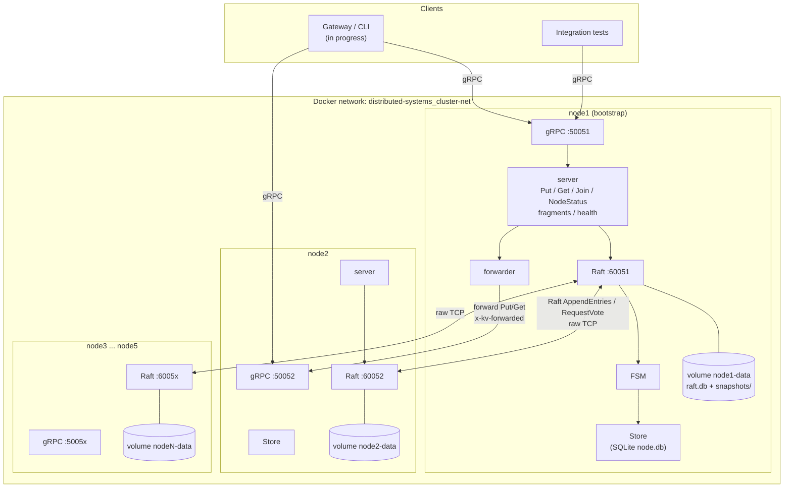
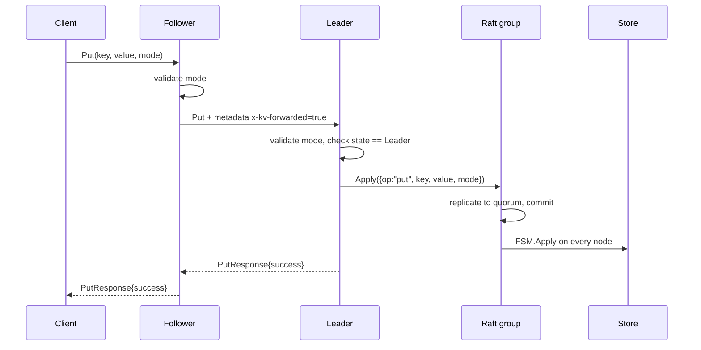
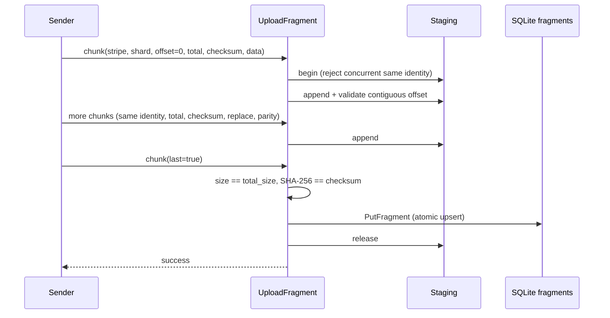

# Architecture

## Topology



Every node runs exactly the same binary. `internal/server` is the gRPC front end,
`internal/consensus.Node` owns the Raft instance and the FSM, and
`internal/storage.Store` is the state-machine backend. Raft log and stable
state live in BoltDB; snapshots and the SQLite database live on the filesystem.

## Package layout

```text
cmd/server        process wiring, flags, startup/shutdown
cmd/gateway       CLI entrypoint (argument parsing and gRPC calls)
cmd/healthcheck   Compose health probe
cmd/bench         benchmark harness placeholder

internal/config      environment parsing and validation
internal/server      gRPC handlers, forwarding, fragment transport
internal/consensus   Raft node, FSM, metadata commands
internal/storage     Store interface, SQLite metadata/fragment/config repositories
internal/redundancy  RS(3,2), five-copy replication, checksums, deterministic placement
internal/gateway     consistent-hash router
internal/cluster     failure detection and repair (created now, populated later)

proto/               storage.proto and committed generated code
tests/               support, unit, integration, chaos, and bench suites
```

Dependency direction:

- `cmd/*` imports domain packages and contains only process/CLI wiring.
- `internal/server` may import `internal/consensus`, `internal/storage`,
  `internal/redundancy`, `internal/config`, and `internal/cluster`.
- Domain packages must never import `internal/server`, `internal/gateway`, or
  `cmd/*`.
- `tests/support` is test-only; production packages must not import it.

The package move was behaviour-preserving. `internal/storage.MockStore` was
removed from production in the SQLite task and now lives in `tests/support`.
`internal/redundancy` now contains the real RS(3,2) and five-copy replication
engines, checksums, and deterministic placement; the no-op placeholder was
removed. See [tests/README.md](../tests/README.md) and
[internal/redundancy/README.md](../internal/redundancy/README.md).

## Redundancy and placement

The store supports two global redundancy modes. A per-request mode override is
allowed; an empty mode resolves to the default, replication.

| Mode | Fragments | Shard layout | Reconstruct from |
| --- | --- | --- | --- |
| `rs32` | 5 | indices `0,1,2` data, `3,4` parity | any 3 distinct shards |
| `replication` | 5 | five full copies, indices `0..4` | any 1 valid copy |

RS(3,2) uses `shardSize = max(1, ceil(size/3))`. The value is copied into the
three data shards, the final shard is zero-padded, and two parity shards are
computed with `github.com/klauspost/reedsolomon`. Decode accepts any three to
five distinct shards, verifies every supplied SHA-256 shard checksum before
reconstruction, rejects duplicate or out-of-range indices and inconsistent
`TotalSize` values, reconstructs at most two missing shards, verifies the parity
matrix, then truncates the concatenated data shards to the original size so
padding never leaks into the result. An empty value is encoded as five one-byte
zero shards.

Replication stores five full copies. Decode returns the first copy with a valid
length and checksum and skips corrupt copies when a good copy exists; if none is
valid, it returns an error listing the mismatches instead of a corrupted value.

Placement is deterministic and mode-aware. The placer sorts the node IDs,
computes `offset = FNV-1a(stripeID) % len(nodes)`, and assigns shard `i` to
`nodes[(offset+i) % len(nodes)]`. It requires exactly five shards and at least
five distinct node IDs. RS indices 3 and 4 are marked parity; every replication
index is data. With five nodes a stripe therefore uses five distinct nodes and
the hash rotation balances ownership across stripes.

Storage math for a non-empty value of `size` bytes:

```text
RS(3,2) total      = 5 * ceil(size/3)  ~= 1.67x  (about 67% extra)
replication total  = 5 * size          =  5.00x  (400% extra)
```

The empty-value exception is five 1-byte RS shards (5 bytes) versus zero bytes
for replication. After a healthy write, any three live nodes hold enough
fragments to satisfy both the Raft quorum and reconstruction, so two node
failures are tolerated. The engines are unit-tested now; tasks 06 and 07 wire
them into the fragment write and read paths.

## Metadata protocol

Raft carries metadata only. The committed record for a key is a
`storage.KeyMeta`:

```go
type KeyMeta struct {
    Key       string
    StripeID  string
    Mode      string // "rs32" or "replication"
    Size      int64
    Checksum  string // SHA-256 hex of the original value
    Version   int64
    Degraded  bool
    Placement []ShardPlacement // five entries, indices 0..4
}
```

The FSM validates every metadata command at the consensus boundary and the
SQLite repository enforces the same invariants transactionally:

1. `Key` and `StripeID` are non-empty; a stripe ID is globally unique.
2. `Mode` is a concrete `rs32` or `replication` value.
3. `Version` is at least 1. A lower version is rejected with `conflict`; an
   equal version is accepted only when stripe ID, checksum, and size match.
4. `Checksum` is 64 hex characters.
5. `Placement` has exactly five entries with distinct indices in `0..4` and
   distinct node IDs. RS marks indices 3 and 4 as parity; replication marks
   every index as data.
6. A degraded write still records the deterministic five-way intended
   placement and sets `Degraded=true`. `set_meta_status` clears the flag after
   repair without changing the version or checksum.

### Commands

| Op | Fields | Behaviour |
| --- | --- | --- |
| `put_meta` | `meta` | Validates and installs a new stripe version. Returns the new metadata and, only for a genuine overwrite with a different stripe ID, the old metadata so the caller can garbage-collect the old fragments. |
| `set_meta_status` | `key`, `stripe_id`, `version`, `degraded` | Updates only the degraded flag for the matching stripe/version. |
| `get_meta` | `key` | Linearizable metadata read; a missing key returns `Found=false`, not an error. |
| `delete_meta` | `key`, optional `version` | Deletes the key and returns its old metadata. A zero version is unconditional; a mismatch returns `conflict` in the same transaction. |
| `set_config` | `config` | Validates and stores the global default mode. |
| `get_config` | — | Reads the global default mode; if absent returns `rs32` without writing. |

`Apply` compares the log index with `raft_state.last_applied_index` before
mutating metadata, so replaying an entry that SQLite already applied is a no-op.
Expected failures are returned as `Result.Err` with stable codes (`conflict`,
`invalid`, `not_found`, `internal`) rather than Go errors; a Raft apply panic is
fatal, so a rejected command must never panic.

The command envelope has no top-level value field. The transitional `put` and
`get` operations keep the old full-value payload inside a nested `LegacyOp`,
which is marked deprecated. Metadata commands are limited to 64 KiB of encoded
JSON; the legacy operations are temporarily exempt because the server still uses
them until task 06. Task 06 stops writing the legacy operations and task 15
removes them.

### Snapshots

The FSM owns a versioned snapshot envelope:

```json
{
  "schema_version": 2,
  "metadata": { "stripes": [], "keys": [], "config": {}, "last_applied_index": 0 },
  "legacy": []
}
```

The `metadata` section contains stripes, key metadata, placements, and the
singleton cluster config, plus `last_applied_index`. It never contains fragment
payloads. The `legacy` section contains the transitional KV rows and is removed
in task 15. Restore rejects unknown schema versions, restores both sections in
one SQLite transaction, and still accepts the version 1 single-section snapshot
and the pre-SQLite raw map for upgrade safety. Restoring
`last_applied_index` prevents older log entries from being re-applied on top of
a newer SQLite state.

## Request path

### Write



1. The mode is validated before anything else (`""`, `replication`, `rs32`).
2. If the receiving node is not the leader, `forwardPut` looks up the current
   leader with `Raft.LeaderWithID()`, maps the leader ID to a gRPC address via
   `PEERS`, and forwards with `x-kv-forwarded=true`, a 5 s deadline, and one
   retry on `Unavailable`.
3. A node that receives a forwarded request but is still not the leader returns
   `FailedPrecondition` instead of forwarding again, so requests cannot loop.
4. The leader wraps the request in a `consensus.Command` and calls
   `Raft.Apply` with a 10 s timeout. The call returns once the entry is
   committed by a quorum.
5. `FSM.Apply` runs on all nodes and writes into the local `Store`.

The sequence above is the transitional legacy path still used by the server. The
metadata protocol and FSM commands are implemented, but task 06 switches the
write path to encode fragments out of band and commit `put_meta`; task 07 does
the same for reads.

### Read

Reads use the same path with `{op:"get"}`. A get command is appended to the Raft
log, committed, and evaluated by the FSM, which returns
`GetResult{Value, Found, Err}` via `future.Response()`. This gives a
**linearizable read** without relying on a leader lease or read-index protocol:
if a read is committed, it observes every write that committed before it.

The cost is that reads consume log space and a round trip through Raft. Log
compaction (`Snapshot()`) bounds the disk usage.

### Other RPCs

| RPC | Behaviour |
| --- | --- |
| `Join` | Leader adds the caller via `AddVoter`. A follower returns `success=false` plus `leader_id` so the caller can retry against the leader. |
| `NodeStatus` | Reports `node_id`, `state`, `leader_id`, `leader_addr`, `term`, `commit_index`, `applied_index`, `last_index`. |
| `UploadFragment` | Stages a stripe-addressed chunk stream, verifies its checksum, and commits it atomically. See [Fragment transport v2](#fragment-transport-v2). |
| `DownloadFragment` | Verifies the stored checksum and streams the fragment in bounded chunks. |
| `DeleteFragment` | Idempotently deletes one local fragment. |
| `DeleteStripeFragments` | Deletes every local fragment for a stripe (overwrite GC). |
| `ListFragments` | Streams local fragment metadata, optionally filtered by stripe. |
| `StatFragment` | Reports fragment size and checksum without a payload. |
| `Repair` | Validates the key and returns a scaffold message; reconstruction belongs to the failure-management subsystem. |
| `Heartbeat` | Legacy liveness RPC. Real health checks use `grpc.health.v1`. |

## Fragment transport v2

The redundancy layer moves shards out of band: Raft carries metadata only, and
each node receives its own fragment through `UploadFragment`. A fragment is
identified by `(stripe_id, shard_index)`; the stripe ID is opaque and shard
indices are global.

| Shard index | RS(3,2) | Replication |
| --- | --- | --- |
| 0, 1, 2 | data shards | full copies |
| 3, 4 | parity shards | full copies |

The transport does not know the stripe's mode, so it derives only what is
unambiguous: indices 0-2 can never be marked parity. Indices 3-4 carry the
sender's `is_parity` flag, which is true for RS parity shards and false for
replication copies.

### Upload



1. The first chunk validates `stripe_id`, `shard_index` (0-4), `total_size`
   (`0..MAX_FRAGMENT_SIZE`), checksum format, and `offset == 0`.
2. Chunks accumulate in a staging slot keyed by `(stripe_id, shard_index)`.
   Every chunk must repeat the same identity, total size, checksum, `replace`,
   and `is_parity`. Each offset must equal the current buffer length; gaps,
   overlaps, and duplicate offsets return `InvalidArgument`.
3. A concurrent upload for the same identity returns `Aborted`; the winner
   keeps the slot. At most 64 fragments are staged per node; further uploads
   return `ResourceExhausted`.
4. On `last=true` the buffer must equal `total_size` and its SHA-256 must equal
   the checksum before `PutFragment` is called. Staging is released on success
   and on every error path.
5. If the fragment already exists with the same checksum, the upload succeeds
   without rewriting (retry-safe). A different checksum returns
   `AlreadyExists` unless `replace=true`, which is reserved for repair.
6. An upload whose stream closes without `last=true`, or that changes any
   repeated field, is rejected and leaves no fragment behind.

`total_size` is the fragment payload size, not the original value size. An
empty replication copy is one zero-length chunk with the SHA-256 of the empty
string. RS shards are never zero-length because encoding uses
`shardSize = max(1, ceil(size/3))`.

### Download

Download requires `(stripe_id, shard_index)` and ignores the legacy fields. The
server verifies the stored checksum, then streams `UPLOAD_CHUNK_SIZE` pieces.
Each message repeats the total size and checksum, carries its byte offset, and
sets `last=true` on the final piece. A zero-length fragment produces exactly one
message with `offset=0`, `total_size=0`, the empty-string checksum, and
`last=true`. Missing fragments return `NotFound`; a stored checksum mismatch
returns `Internal`.

### Maintenance

`DeleteFragment` is idempotent and reports `absent` for a missing fragment.
`DeleteStripeFragments` removes every local fragment for a stripe and reports
how many it removed. `ListFragments` streams metadata only; an empty
`stripe_id` lists every local fragment, which repair uses to detect missing
shards. `StatFragment` returns size and checksum without transferring payload
bytes. The transport never decides whether a stripe is current; superseded
stripe cleanup belongs to metadata garbage collection.

### Limits and compatibility

| Env | Default | Meaning |
| --- | --- | --- |
| `MAX_FRAGMENT_SIZE` | `64MiB` | Largest complete fragment payload. |
| `MAX_MESSAGE_SIZE` | `32MiB` | Largest single gRPC request or response; applied to the server and forwarding dials. |
| `UPLOAD_CHUNK_SIZE` | `1MiB` | Preferred chunk size for uploads and the download chunk size. |
| `FRAGMENT_TIMEOUT` | `10s` | Deadline for one upload, download, delete, list, or stat operation. |

The legacy `key`, `index`, and `is_parity` request fields and their field
numbers remain in the proto so old clients compile and old messages decode.
V2 handlers ignore `key`/`index` and reject a request without `stripe_id`.

## Raft configuration

| Setting | Value | Notes |
| --- | --- | --- |
| Log store | `raft-boltdb/v2` at `<data>/raft.db` | Same file also serves as stable store |
| Snapshot store | `raft.NewFileSnapshotStore(<data>, 3, stderr)` | Keeps three snapshots |
| Transport | `raft.NewTCPTransport` on `0.0.0.0:<RAFT_PORT>` | Advertised as `NODE_ID:<RAFT_PORT>` |
| Election/heartbeat | Library defaults (1 s heartbeat, 1 s election timeout) | Appropriate for a local Docker network |
| Bootstrap | `BootstrapCluster` only when `BOOTSTRAP=true`, a configuration is supplied, and `raft.HasExistingState` is false | Prevents re-bootstrapping a node that already has state |
| Membership change | `AddVoter` through the `Join` RPC | One server at a time |

Startup order is flexible but deterministic in Compose: node1 bootstraps the
five-server configuration, then nodes 2-5 start (they wait for node1's health
check) and discover the existing cluster through their persisted state or, if
`JOIN_ADDR` is set, by calling `Join`.

## Data layout

```
/data/
├── node.db              # SQLite metadata, local fragments, legacy KV state
├── node.db-wal          # SQLite write-ahead log (present while open)
├── node.db-shm          # SQLite shared-memory index (present while open)
├── raft.db              # BoltDB buckets: logs, stable (term/vote), configuration
└── snapshots/
    ├── <term>-<index>-<timestamp>.meta
    └── <term>-<index>-<timestamp>.state
```

SQLite is opened before Raft starts and closed after Raft and gRPC stop. It
holds the legacy full-value `store` table during the transition, the metadata
tables used by later tasks (`keys`, `stripes`, `placements`), local `fragments`,
the singleton `cluster_config`, and `raft_state.last_applied_index`.

Raft snapshots use the FSM's `schema_version: 2` envelope. The metadata section
covers the `keys`, `stripes`, `placements`, `cluster_config`, and
`raft_state` tables and deliberately excludes fragment payloads: fragments are
durable on their owner nodes and repaired from peers when missing. Until task 06
the FSM still writes the legacy `store` table, so the envelope also carries a
legacy section. Restore applies both sections in one transaction and still
accepts version 1 snapshots and the pre-SQLite raw map.

The `fragments` table is written by the fragment transport v2 upload handler.
The client write path does not call that handler until task 06 wires the
redundancy engines into `Put`; until then fragments are only created by direct
transport calls and tests.

## Consistency model

- **Writes** are linearizable: they return only after a quorum commits them.
- **Reads** are linearizable: they are committed through the log before being
  served.
- **Follower reads** are forwarded to the leader, so a follower never serves
  stale local data through the public API.
- **Catch-up** is “eventually consistent” only for internal replica state while
  it is behind; it converges as soon as the leader replicates to it.
- **No quorum, no progress**: with fewer than three of five nodes alive, writes
  and reads time out rather than serving stale data.

## Failure and recovery

| Scenario | Behaviour |
| --- | --- |
| Follower dies | Quorum (3/5) still commits. On restart the follower's BoltDB log replays, then the leader streams the missing entries. |
| Leader dies | Remaining nodes elect a new leader after the election timeout. Followers re-resolve the leader on the next request. |
| Leader restarts | It rejoins as a follower using its persisted log and configuration; a new leader may already exist. |
| Whole cluster restarts | Each node reopens `raft.db` and `node.db`, restores state, and rejoins the persisted configuration; the leader is re-elected. |
| Log grows | Raft triggers a snapshot; the FSM serializes the store, and old log entries are truncated. |
| Stale membership | `BOOTSTRAP_SERVERS` is only applied to a node with no state, so live membership changes survive restarts. |

## Why Raft uses raw TCP instead of gRPC

`hashicorp/raft` defines a byte-oriented `Transport` interface with its own
framing, deadlines, and connection pooling. Wrapping it in gRPC would add a
serialization layer to every heartbeat and `AppendEntries` batch without
improving correctness or tooling. Separating the ports also keeps consensus
traffic isolated from client traffic, which makes failure diagnosis simpler:
a healthy gRPC port with a broken Raft port is an immediately visible symptom.

The trade-off is one extra port per node and no TLS on the Raft link, which is
acceptable for a course deployment on a private Docker network and is recorded
in [DECISIONS.md](DECISIONS.md) (ADR-001).

## Known limitations

- The server write path still stores the full value through the legacy `put`
  command in the `store` table. Metadata commands, validation, idempotency, and
  snapshots are implemented; task 06 wires them into the write path and task 07
  into reads.
- The write and read paths do not call the fragment transport yet; task 06
  wires uploads into `Put` and task 07 wires downloads into `Get`. Fragments are
  only written to the `fragments` table when the transport is called directly,
  for example by tests or repair paths.
- `x-kv-forwarded` prevents loops but assumes `PEERS` is complete and correct.
- Reads append log entries (no read-index optimisation yet).
- The redundancy engines and placement are implemented and unit-tested, but the
  server write/read path does not call them until tasks 06 and 07. Repair is
  still a scaffold.
- TLS is optional but not provisioned automatically; the Compose cluster runs
  in plaintext.
- Raft membership changes go through `Join`; there is no automatic rebalancing.
