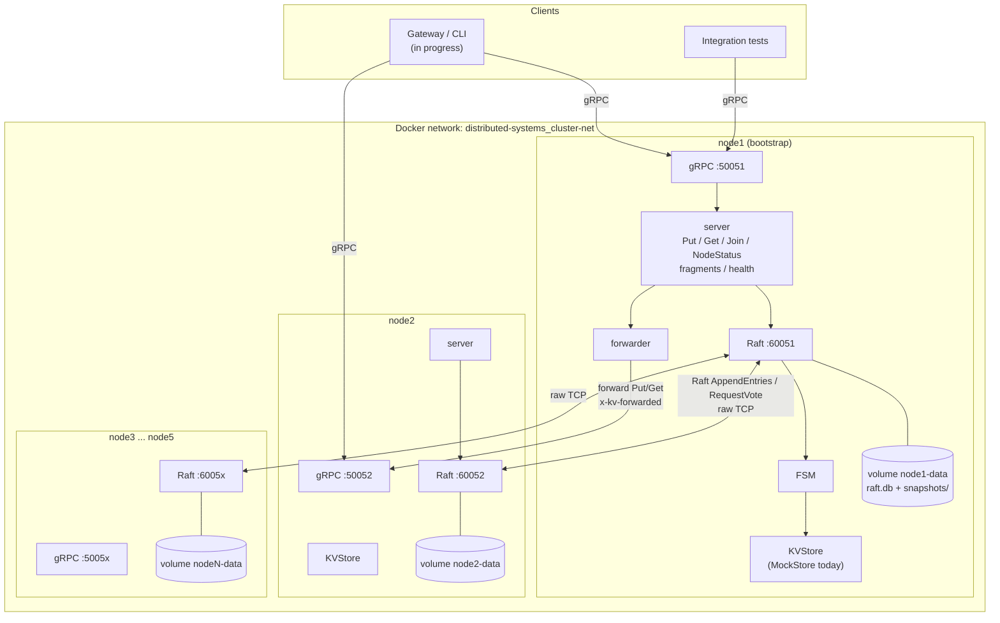
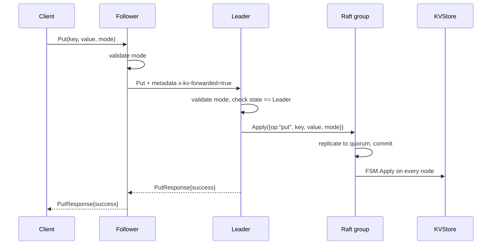

# Architecture

## Topology



Every node runs exactly the same binary. `server` is the gRPC front end,
`consensus.Node` owns the Raft instance and the FSM, and `storage.KVStore` is
the state-machine backend. Raft log and stable state live in BoltDB; snapshots
live on the filesystem.

## Request path

### Write



1. The mode is validated before anything else (`""`, `replication`, `rs32`).
2. If the receiving node is not the leader, `forwardPut` looks up the current
   leader with `Raft.LeaderWithID()`, maps the leader ID to a gRPC address via
   `PEERS`, and forwards with `x-kv-forwarded=true`, a 5 s deadline, and one
   retry on `Unavailable`.
3. A node that receives a forwarded request but is still not the leader returns
   `FailedPrecondition` instead of forwarding again, so requests cannot loop.
4. The leader wraps the request in a `consensus.Command` and calls
   `Raft.Apply` with a 10 s timeout. The call returns once the entry is
   committed by a quorum.
5. `FSM.Apply` runs on all nodes and writes into the local `KVStore`.

### Read

Reads use the same path with `{op:"get"}`. A get command is appended to the Raft
log, committed, and evaluated by the FSM, which returns
`GetResult{Value, Found, Err}` via `future.Response()`. This gives a
**linearizable read** without relying on a leader lease or read-index protocol:
if a read is committed, it observes every write that committed before it.

The cost is that reads consume log space and a round trip through Raft. Log
compaction (`Snapshot()`) bounds the disk usage.

### Other RPCs

| RPC | Behaviour |
| --- | --- |
| `Join` | Leader adds the caller via `AddVoter`. A follower returns `success=false` plus `leader_id` so the caller can retry against the leader. |
| `NodeStatus` | Reports `node_id`, `state`, `leader_id`, `leader_addr`, `term`, `commit_index`, `applied_index`, `last_index`. |
| `UploadFragment` | Consumes a chunk stream and stores each chunk under `key#dN` / `key#pN`. |
| `DownloadFragment` | Looks up the chunk by key and index and streams it back. |
| `Repair` | Validates the key and returns a scaffold message; reconstruction belongs to the failure-management subsystem. |
| `Heartbeat` | Legacy liveness RPC. Real health checks use `grpc.health.v1`. |

## Raft configuration

| Setting | Value | Notes |
| --- | --- | --- |
| Log store | `raft-boltdb/v2` at `<data>/raft.db` | Same file also serves as stable store |
| Snapshot store | `raft.NewFileSnapshotStore(<data>, 3, stderr)` | Keeps three snapshots |
| Transport | `raft.NewTCPTransport` on `0.0.0.0:<RAFT_PORT>` | Advertised as `NODE_ID:<RAFT_PORT>` |
| Election/heartbeat | Library defaults (1 s heartbeat, 1 s election timeout) | Appropriate for a local Docker network |
| Bootstrap | `BootstrapCluster` only when `BOOTSTRAP=true`, a configuration is supplied, and `raft.HasExistingState` is false | Prevents re-bootstrapping a node that already has state |
| Membership change | `AddVoter` through the `Join` RPC | One server at a time |

Startup order is flexible but deterministic in Compose: node1 bootstraps the
five-server configuration, then nodes 2-5 start (they wait for node1's health
check) and discover the existing cluster through their persisted state or, if
`JOIN_ADDR` is set, by calling `Join`.

## Data layout

```
/data/
├── raft.db            # BoltDB buckets: logs, stable (term/vote), configuration
└── snapshots/
    ├── <term>-<index>-<timestamp>.meta
    └── <term>-<index>-<timestamp>.state
```

The KV payload itself is not written directly to disk today; it is rebuilt on
startup by replaying the Raft log and restoring the newest snapshot into the
store. This is why `storage.Snapshotter` matters: a store that implements it can
be snapshotted and restored as a whole, and `MockStore` does so with JSON.

## Consistency model

- **Writes** are linearizable: they return only after a quorum commits them.
- **Reads** are linearizable: they are committed through the log before being
  served.
- **Follower reads** are forwarded to the leader, so a follower never serves
  stale local data through the public API.
- **Catch-up** is “eventually consistent” only for internal replica state while
  it is behind; it converges as soon as the leader replicates to it.
- **No quorum, no progress**: with fewer than three of five nodes alive, writes
  and reads time out rather than serving stale data.

## Failure and recovery

| Scenario | Behaviour |
| --- | --- |
| Follower dies | Quorum (3/5) still commits. On restart the follower's BoltDB log replays, then the leader streams the missing entries. |
| Leader dies | Remaining nodes elect a new leader after the election timeout. Followers re-resolve the leader on the next request. |
| Leader restarts | It rejoins as a follower using its persisted log and configuration; a new leader may already exist. |
| Whole cluster restarts | Each node reopens `raft.db`, restores state, and rejoins the persisted configuration; the leader is re-elected. |
| Log grows | Raft triggers a snapshot; the FSM serializes the store, and old log entries are truncated. |
| Stale membership | `BOOTSTRAP_SERVERS` is only applied to a node with no state, so live membership changes survive restarts. |

## Why Raft uses raw TCP instead of gRPC

`hashicorp/raft` defines a byte-oriented `Transport` interface with its own
framing, deadlines, and connection pooling. Wrapping it in gRPC would add a
serialization layer to every heartbeat and `AppendEntries` batch without
improving correctness or tooling. Separating the ports also keeps consensus
traffic isolated from client traffic, which makes failure diagnosis simpler:
a healthy gRPC port with a broken Raft port is an immediately visible symptom.

The trade-off is one extra port per node and no TLS on the Raft link, which is
acceptable for a course deployment on a private Docker network and is recorded
in [DECISIONS.md](DECISIONS.md) (ADR-001).

## Known limitations

- The store is still the in-memory mock; SQLite persistence is in progress.
- `x-kv-forwarded` prevents loops but assumes `PEERS` is complete and correct.
- Reads append log entries (no read-index optimisation yet).
- Reed-Solomon encoding (`rs32`) and repair are interfaces/scaffolds only.
- TLS is optional but not provisioned automatically; the Compose cluster runs
  in plaintext.
- Raft membership changes go through `Join`; there is no automatic rebalancing.
